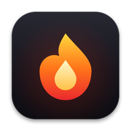
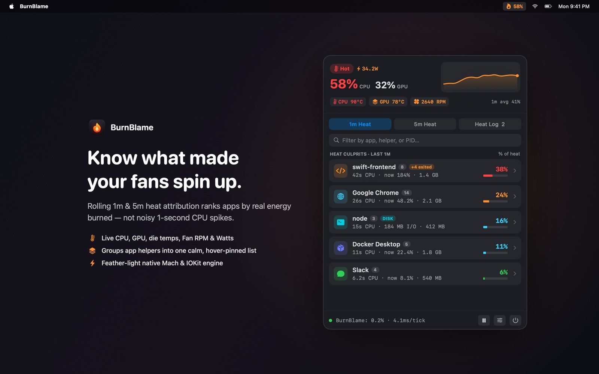
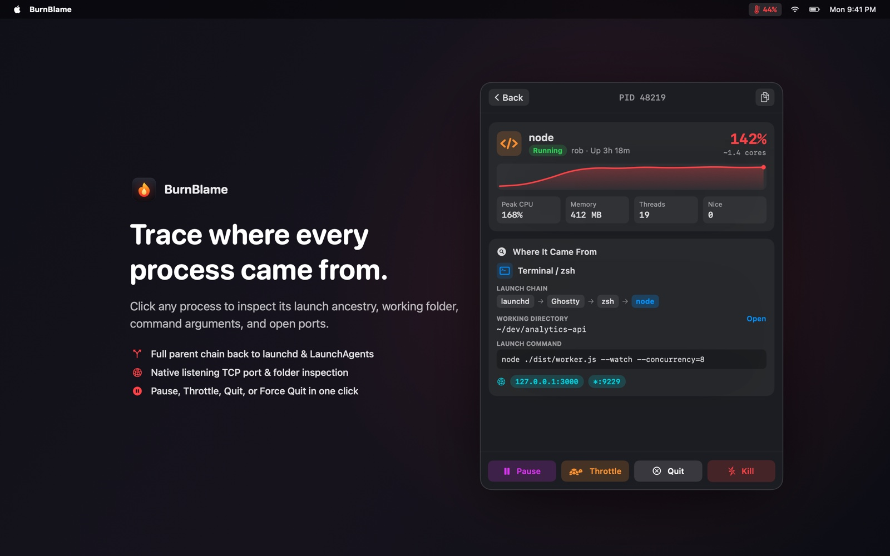
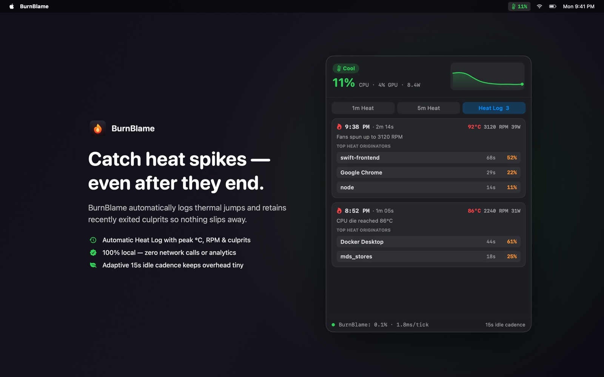

<h1>&nbsp; BurnBlame</h1>

**Know what made your MacBook fans spin up — and deal with it in seconds.**

[](#installation)
[](#installation)
[](#build-from-source)
[](https://github.com/arosemena/burnblame/releases/latest)
[](#architecture--privacy)

BurnBlame is a feather-light, native macOS menu bar utility built in Swift and SwiftUI. Instead of showing a noisy, jumping list of instantaneous CPU percentages, BurnBlame tracks **real hardware thermals** and **rolling heat burned over time**, rolls up helper processes under their parent app, and lets you forensically inspect *where* a runaway process came from and take action right from the menu bar.

<p align="center">
  
</p>

---

## Installation

### Homebrew (Recommended)

```bash
brew tap arosemena/burnblame https://github.com/arosemena/burnblame
brew install --cask burnblame
```

### Direct Download (Notarized `.dmg`)

Download the latest Apple-notarized Universal `.dmg` from [GitHub Releases](https://github.com/arosemena/burnblame/releases/latest) and drag **BurnBlame.app** into `/Applications`.

> **Tip:** To start BurnBlame automatically when you log in, open **System Settings → General → Login Items & Extensions** and add `BurnBlame.app`.

---

## Why BurnBlame?

Standard activity monitors act like speedometers, not heat detectors:

- **Fans respond to accumulated heat, not 1-second spikes.** By the time you hear your fans, a bursty compiler or script may have already cooled down or exited.
- **Instantaneous lists jump under your cursor.** Trying to click a process while rows reshuffle every second is frustrating.
- **Modern apps fragment across dozens of helpers.** Browsers, Electron apps, and build tools spawn 10–30 helpers that individually look small while collectively cooking your laptop.

BurnBlame solves all three while staying lean in the background.

---

## Key Features

### Real-Time Thermal & Heat Attribution (`1m` & `5m`)
- **Hardware Telemetry (Rootless):** Live **CPU & GPU die temperatures (°C)**, **Fan RPM**, **System Power (Watts)**, **GPU utilization %**, and macOS thermal pressure.
- **Unified Rolling Heat Score:** Ranks apps by CPU-seconds burned + Disk I/O energy over the last **1 minute** or **5 minutes**, displayed as a clear **% share of total heat**.
- **Grouped & Hover-Pinned:** Rolls helpers and nested `.app` bundles under their parent app, retains **recently exited culprits** (`EXITED` badge), catches `root` / system processes (`WindowServer`, `mds_stores`, `kernel_task`) on demand, and **freezes row order while hovering** so nothing jumps out from under your cursor.

### On-Demand Forensic Process Inspector
Click any process to answer *"where did this come from and is it a mistake?"*:
- **Launch Origin & Parent Chain:** Identifies App Bundles, Terminal/Shell sessions, and `LaunchAgents` / `LaunchDaemons` `.plist` files with a full breadcrumb trail back to `launchd`.
- **Working Directory, Command Line & Open Ports:** Open the working folder, reveal the binary in Finder, copy the full command line (`KERN_PROCARGS2`), and spot forgotten dev servers via native listening TCP port detection.
- **Direct Actions:** **Pause / Resume** (`SIGSTOP`/`SIGCONT`), **Throttle** (`renice +15`), **Quit** (`SIGTERM`), **Force Quit** (`SIGKILL` with confirmation), and **Copy Diagnostics**.

<p align="center">
  
</p>

### Automatic Heat Log
Whenever fans spin up, die temperatures climb, or sustained load occurs, BurnBlame automatically snapshots the event (timestamp, duration, peak °C / RPM / Watts, and top culprits) so you can see what triggered your fans even minutes later.

<p align="center">
  
</p>

---

## Architecture & Privacy

- **Native Syscalls Only:** Built directly on Mach (`host_statistics`), `libproc`, `sysctl`, and IOKit (`IOAccelerator`, cached `AppleSMC` key descriptors) — zero third-party dependencies.
- **Adaptive Sampling:** Stretches full background scans to every **15s** when closed and cool (waking immediately on any CPU, GPU, or thermal spike), defers list diffs while trackpad-scrolling, and displays its own live CPU% & `ms/tick` overhead right in the footer.
- **100% Local & Private:** Zero network requests, zero analytics, zero data collection.

---

## Build from Source

Requires **macOS 14.0 (Sonoma)+** and **Xcode / Swift 6.0+**.

```bash
git clone git@github.com:arosemena/burnblame.git
cd burnblame
./scripts/build-app.sh
open dist/BurnBlame.app
```

Run tests with:
```bash
swift test
```
