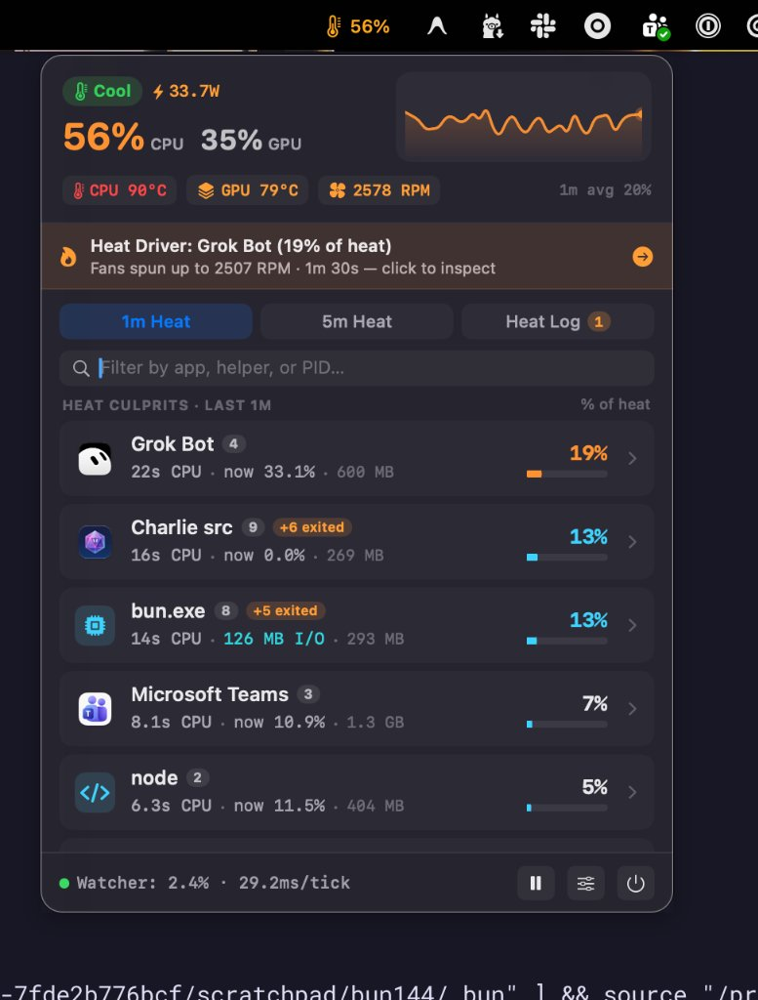

# BurnBlame

**Find out what made your MacBook fans spin up — and deal with it in seconds.**

[](#installation)
[](#build-from-source)
[](#why-burnblame)
[](#architecture--performance)

BurnBlame is a feather-light, native macOS menu bar utility built in Swift and SwiftUI. Instead of showing a noisy, jumping list of instantaneous CPU percentages, BurnBlame tracks **real hardware thermals** and **rolling heat burned over time**, rolls up helper processes under their parent app, and lets you forensically inspect *where* a runaway process came from and take action right from the menu bar.

<p align="center">
  
</p>

---

## Why BurnBlame?

Standard process monitors are built like speedometers, not heat detectors:

- **Fans respond to accumulated heat, not 1-second spikes.** By the time you hear your fans, a bursty compiler or script may have already cooled down or exited.
- **Instantaneous lists jump under your cursor.** Trying to click a process while rows reshuffle every second is frustrating.
- **Modern apps fragment across dozens of helpers.** Chrome, Electron apps, and build tools spawn 10–30 helper processes that individually look small while collectively cooking your laptop.

BurnBlame solves all three while staying under ~0.1% CPU when idle.

---

## Key Features

### Real-Time Thermal & Hardware Telemetry
- **AppleSMC Hardware Sensors** (rootless): Live **CPU die temperature (°C)**, **GPU die temperature (°C)**, **Fan RPM**, and **System Power draw (Watts)**.
- **GPU & Thermal Pressure**: Live system **GPU utilization %** via IOKit (`IOAccelerator`) combined with macOS `ProcessInfo.thermalState`.
- **Automatic Heat Event Log**: Whenever fans spin up (≥ 2,000 RPM), die temperatures climb (≥ 85°C), thermal pressure escalates, or sustained load occurs, BurnBlame snapshots the event (time, duration, peak °C/RPM/W, and top 3 culprits) so you can see what triggered your fans even minutes later.

### Calm, Rolling Heat Attribution (`1m` & `5m`)
- **Unified Heat Score**: Ranks apps by rolling CPU-seconds burned + Disk I/O energy over the last **1 minute** or **5 minutes**, displayed as a clear **% share of total heat**.
- **App & Process-Family Grouping**: Automatically rolls nested `.app` helpers (e.g., Chromium/Electron helpers) and parallel CLI workers (`swift-frontend`, `bun`, `node`) into one calm row; click to expand and inspect individual children.
- **Recently Exited Culprits**: Hit-and-run build tasks or cron scripts that burned heat and exited stay visible with an `EXITED` badge until they age out of the window.
- **On-Demand `root` Attribution**: Automatically catches protected system culprits (`WindowServer`, `mds_stores`, `kernel_task`, etc.) whenever user processes don't account for total system load.
- **Zero-Jitter UX**: Row order automatically freezes while your cursor hovers over the list (`Order pinned`), and sort hysteresis prevents near-ties from swapping back and forth.

### On-Demand Forensic Process Inspector
Click any process to answer *"where did this come from and is it a mistake?"* (runs on a dedicated background queue only when clicked):
- **Launch Origin**: Identifies App Bundles, Terminal/Shell sessions, parent apps, and matching `LaunchAgents` / `LaunchDaemons` `.plist` files (with one-click reveal).
- **Parent Ancestry Chain**: Visual breadcrumb trail back to `launchd` (e.g., `launchd → Terminal → zsh → npm → node`).
- **Working Directory & Executable Path**: Open the working folder or reveal the binary in Finder.
- **Full Command Line**: Extracted natively via `sysctl(KERN_PROCARGS2)` with one-click copy.
- **Listening TCP Ports**: Native socket inspection via `PROC_PIDFDSOCKETINFO` to spot forgotten dev servers.

### Direct Process Actions
- **Pause / Resume (`SIGSTOP` / `SIGCONT`)**: Freeze a runaway process without losing its state while you investigate.
- **Throttle (`renice +15`)**: Lower CPU scheduling priority so a heavy job stops choking your Mac.
- **Quit (`SIGTERM`)** & **Force Quit (`SIGKILL` with two-step confirmation)**.
- **Copy Diagnostics**: Copies PID, metrics, ancestry, working directory, ports, and command line to your clipboard.

---

## Installation

### Homebrew (Recommended once released)

```bash
brew tap arosemena/burnblame https://github.com/arosemena/burnblame
brew install --cask burnblame
```

### Requirements (Build from Source)
- **macOS 14.0 (Sonoma)** or later (Apple Silicon or Intel)
- **Xcode / Swift 6.0+**

### Build & Install `BurnBlame.app`

```bash
git clone git@github.com:arosemena/burnblame.git
cd burnblame
./scripts/build-app.sh
```

Move the built app into `/Applications` and launch it:

```bash
cp -R dist/BurnBlame.app /Applications/
open /Applications/BurnBlame.app
```

> **Tip:** To start BurnBlame automatically when you log in, open **System Settings → General → Login Items & Extensions** and add `BurnBlame.app`.

### Run Directly via SwiftPM (Development)

```bash
swift run
```

### Run Unit Tests

```bash
swift test
```

---

## Architecture & Performance

BurnBlame is engineered to stay invisible while monitoring:

- **Native Syscalls Only**: Uses Mach `host_statistics` (~0.02ms), `libproc` (`proc_listallpids`, `proc_pidinfo`, `proc_pid_rusage`), `sysctl`, and IOKit (`IOAccelerator`, cached `AppleSMC` key descriptors).
- **Adaptive Sampling**:
  - **Closed & Cool**: Micro CPU check every 3s; full sensor/process scan stretches to every **15s** (snaps back immediately on any CPU, GPU, or thermal spike).
  - **Open**: Smooth 2s live updates, deferred automatically during active trackpad scrolling (`NSScrollView.willStartLiveScrollNotification`).
- **Lean UI**: Borderless floating `NSPanel`, pre-rasterized 2× Retina `CGImage` icon cache, and `Equatable`-gated rows. Live self-overhead (`BurnBlame: X.X% · X.Xms/tick`) is always visible in the footer and broken down per sensor in Settings.
- **100% Local**: No network access, no analytics, no third-party dependencies.

---

## Distribution & Publishing

See [`docs/PUBLISHING.md`](docs/PUBLISHING.md) for the complete release pipeline:
- **Direct Notarized `.dmg`** (`./scripts/release-direct.sh`) — Universal `arm64` + `x86_64`, Developer ID signed & Apple notarized (full hardware sensors + process actions).
- **Homebrew Cask** ([`Casks/burnblame.rb`](Casks/burnblame.rb)) — One-command install & upgrade.
- **Mac App Store `.pkg`** (`./scripts/release-mas.sh`) — Sandboxed build (`-DAPP_STORE`) ready for App Store Connect.
